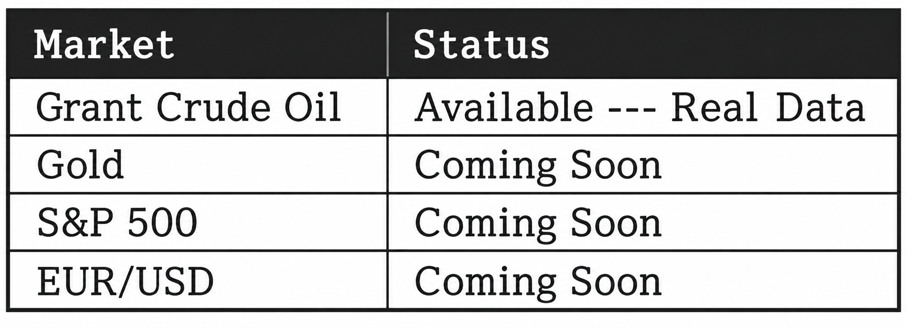
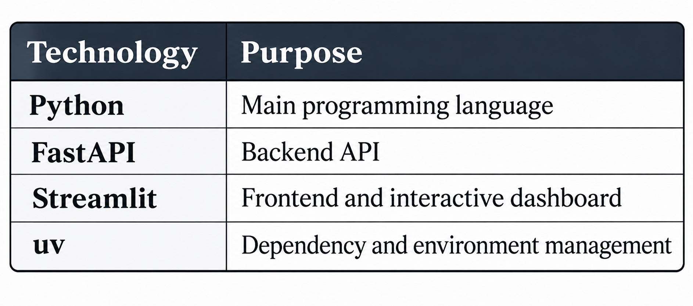

# The Real Market

### Making market data meaningful.

The Real Market is a quantitative market analysis platform designed to
transform raw financial data into meaningful indicators, helping users
understand market behavior, monitor price movements, and eventually
identify anomalies in financial time series.

The project is currently in early development, starting with Brent crude
oil as its first supported market.

------------------------------------------------------------------------

## Overview

Financial markets generate large amounts of historical data, but raw
prices alone do not always provide a clear understanding of market
behavior.

The Real Market aims to bridge this gap by combining market monitoring,
quantitative analysis, and anomaly detection in an accessible platform.

Users will be able to explore market data, analyze historical periods,
and identify unusual movements through statistical indicators and
interactive visualizations.

## Current Status

**Early Development**

The project is actively being developed. Its initial implementation
focuses on acquiring real market data, processing it, and making it
accessible through a web interface and API.

### Supported Markets


### Implemented Features

-   Real daily Brent crude oil data acquisition.
-   CSV data retrieval through HTTP.
-   Data processing and normalization.
-   Latest available Brent price and observation date.
-   Percentage price variation.
-   FastAPI backend.
-   Streamlit frontend.
-   Initial automated tests for backend functions.

### In Development

-   Expanded historical market analysis.
-   Additional quantitative indicators.
-   Improved dashboard experience.
-   Integration of additional financial markets.

------------------------------------------------------------------------

## Tech Stack


------------------------------------------------------------------------

## Architecture

The project follows a client-server architecture, separating the user
interface from the backend responsible for data acquisition and
processing.

``` text
                  THE REAL MARKET

                 ┌───────────────┐
                 │   Streamlit   │
                 │   Frontend    │
                 └───────┬───────┘
                         │
                      HTTP
                         │
                 ┌───────▼───────┐
                 │    FastAPI    │
                 │    Backend    │
                 └───────┬───────┘
                         │
                 ┌───────▼───────┐
                 │  Data Source  │
                 │  DataHub/EIA  │
                 └───────────────┘
```

The backend is responsible for retrieving and processing market data,
while the frontend presents the information through an interactive
dashboard.

------------------------------------------------------------------------

## Data Sources

The initial Brent crude oil dataset is distributed by **DataHub**, using
the original series from the U.S. Energy Information Administration
(EIA).

-   **Original source:** U.S. Energy Information Administration (EIA)
-   **Dataset distributor:** DataHub
-   **Series:** Europe Brent Spot Price FOB
-   **Frequency:** Daily
-   **Unit:** USD per barrel

References:

-   [EIA --- Europe Brent Spot Price
    FOB](https://www.eia.gov/dnav/pet/hist/rbrteD.htm)
-   [DataHub --- Oil Prices Dataset](https://datahub.io/core/oil-prices)

------------------------------------------------------------------------

## Getting Started

### Prerequisites

-   Python
-   [uv](https://docs.astral.sh/uv/)

### Installation

Clone the repository:

``` bash
git clone https://github.com/furtinihenrique/the-real-market.git
cd the-real-market
```

Install the project dependencies:

``` bash
uv sync
```

Create the required `.env` file with the environment variables expected
by the application.

### Running the Application

Start the FastAPI backend:

``` bash
uv run uvicorn backend.app.main:app --reload
```

Start the Streamlit frontend in a separate terminal:

``` bash
uv run streamlit run frontend/app.py
```

The application will be available locally at:

-   **Frontend:** http://localhost:8501
-   **Backend:** http://127.0.0.1:8000
-   **API Documentation:** http://127.0.0.1:8000/docs

------------------------------------------------------------------------

## Roadmap

The long-term vision for The Real Market includes:

-   [ ] Expand market coverage with additional commodities and financial
    assets.
-   [ ] Implement additional quantitative indicators.
-   [ ] Introduce statistical anomaly detection using Z-score and
    Rolling Z-score.
-   [ ] Explore volatility-based regime change detection.
-   [ ] Improve interactive charts and historical analysis.
-   [ ] Expand automated testing and data validation.
-   [ ] Improve application reliability and overall architecture.

------------------------------------------------------------------------

## Project Motivation

The Real Market is a personal software engineering project focused on
applying programming, data processing, and quantitative methods to a
real-world financial domain.

Beyond building a market dashboard, the goal is to develop a system that
transforms raw data into useful information through well-structured
software and statistical analysis.

The project is continuously evolving, and its implementation,
calculations, and edge cases are being validated throughout development.

------------------------------------------------------------------------

## Development Philosophy

The Real Market is developed with a strong emphasis on understanding,
engineering decisions, and hands-on implementation.

AI tools have been used selectively as auxiliary resources in specific
stages of development, mainly to support research, clarify technical
concepts, and improve development efficiency.

**All project architecture, technical decisions, core logic, and
implementation remain under the developer's direct responsibility and
manual control.** AI assistance does not replace the engineering
process, code comprehension, testing, or validation.

The goal is not simply to make things work, but to understand how and
why they work.

------------------------------------------------------------------------

## Author

Developed by **Henrique Araujo Furtini**.

-   [GitHub](https://github.com/furtinihenrique)

------------------------------------------------------------------------

## Copyright

© 2026 The Real Market. All Rights Reserved.

The source code, project structure, documentation, design, and original
materials of The Real Market are protected by applicable copyright laws.

No part of this project may be reproduced, redistributed, or
commercially exploited without prior permission from the author, except
where otherwise permitted by applicable law.

**The Real Market --- Simplicity and market, here, now.**
